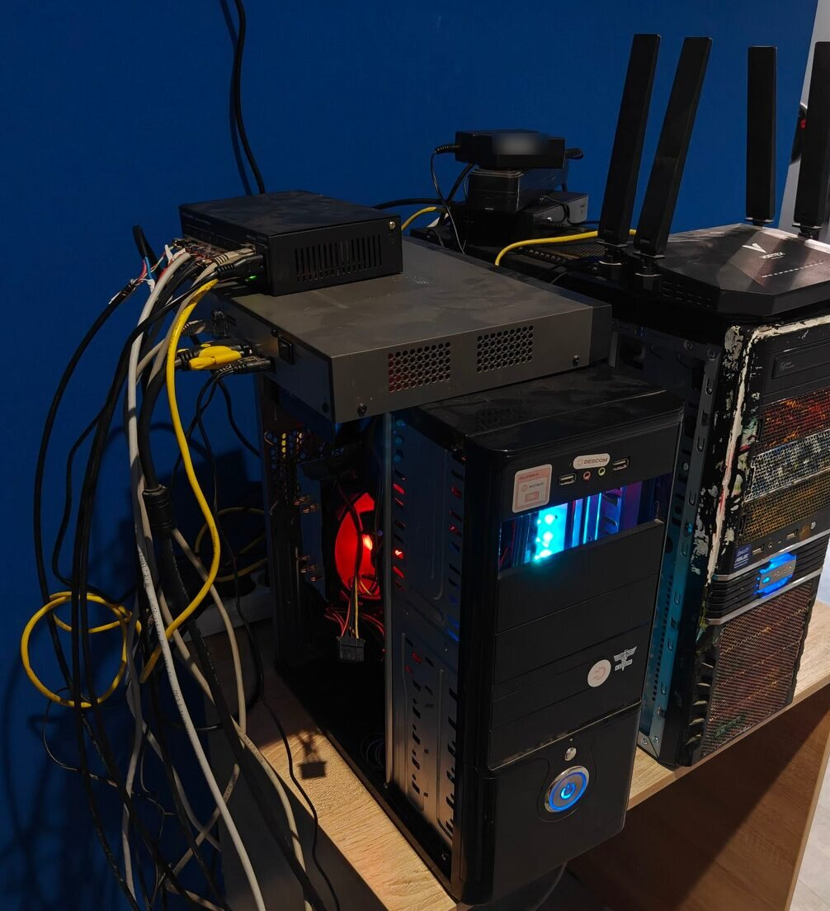
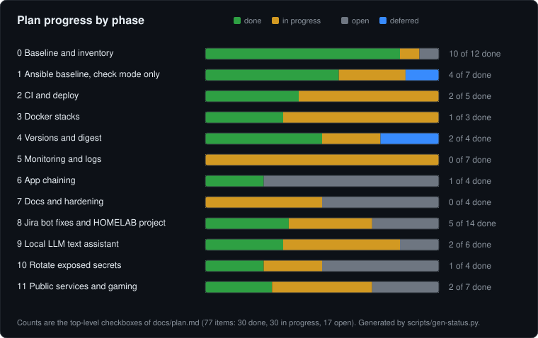
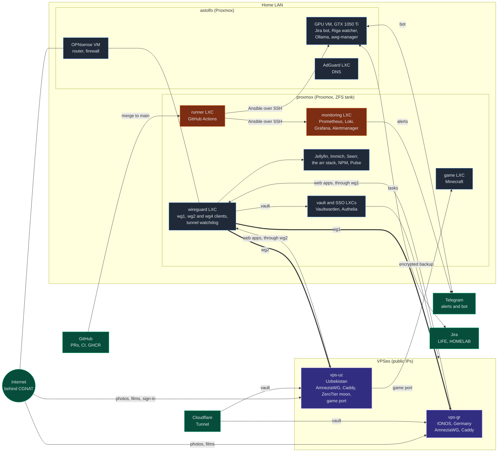
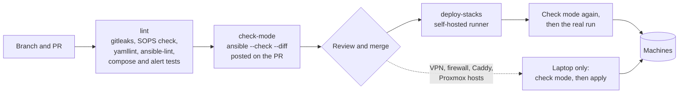
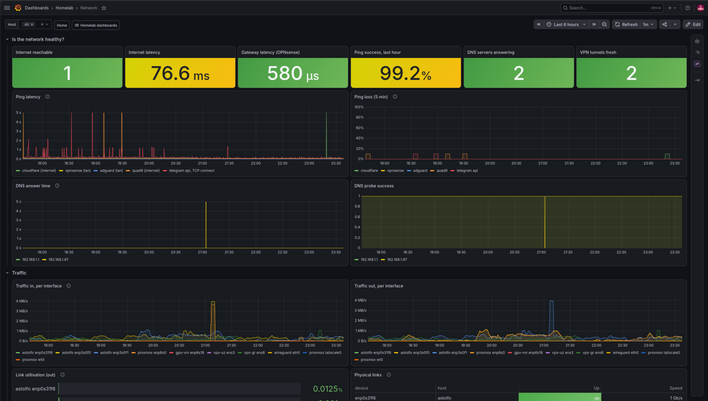
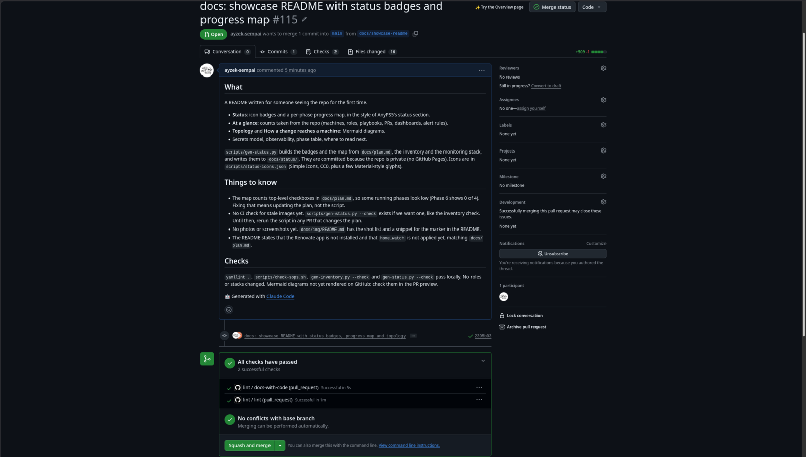
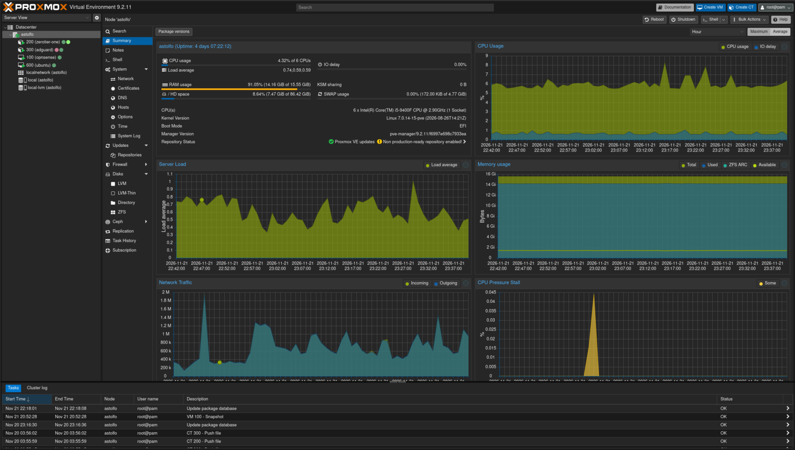

<div align="center">

# infra

**A homelab and two VPSes run as code.**
Every change is a pull request. A merged PR is the only way anything reaches a machine.

     

</div>

<p align="center">
  
  
</p>
<p align="center"><sub><b>The production environment.</b> Two PCs, a switch, a router, a UPS and a desk. Cable management is a future phase. If it works, it works.</sub></p>

> This is the public showcase of a private GitOps repository. The playbooks, the encrypted secrets, the runbooks
> and the captures of the hosts stay private. What you see here is a snapshot: the numbers and the status map
> are from 2026-11-27, the screenshots from 2026-11-21 to 2026-11-22.

---

## Status

    



<sub>Generated from docs/plan.md, the inventory and the monitoring stack by scripts/gen-status.py. Counts are top-level checklist items, so a phase that is running but still has open follow-ups shows partly filled. Rerun the script in any PR that changes the plan.</sub>

---

## At a glance

<!-- Numbers as of 2026-11-27. Source: ansible/inventory, `git log`, `gh pr list`, stacks/monitoring. -->

| | | | |
| :---: | :---: | :---: | :---: |
| **26** machines in the inventory | **20** LXCs, **2** VMs, **2** Proxmox nodes, **2** VPSes | **38** Ansible roles | **38** playbooks |
| **281** merged pull requests | **447** commits in 37 days | **5** Compose stacks, every image pinned | **29** pinned versions in `versions.yml` |
| **9** Grafana dashboards, **141** panels | **82** alert rules, each tested in CI | **30 days** of logs in Loki | **39** runbooks, **10** decision records |

About 19,000 lines of YAML, Python and shell. Little is open to the internet, on purpose: each public path is added one at a time, after its written conditions are met.

---

## Topology

Home sits behind CGNAT, so nothing can connect in. Every path to the outside world goes out from home, through two AmneziaWG tunnels to VPSes in Germany and Uzbekistan.



The VPSes also act as a dead-man switch: if home stops answering, they message Telegram on their own, because the monitoring stack that would normally send the alert is the thing that went down. The `home_watch` role runs on both VPSes and on the monitoring LXC (`home_online` says when home is back), and is applied by hand, one machine at a time. A few things are reachable from outside: the password vault, through a Cloudflare Tunnel with a connector on each VPS and the vault's own login; one game port on `vps-uz`; and since 2026-11-27 Immich (photos) and Jellyfin (films) through Caddy on the VPSes, each under two names (one per region), signed in through Authelia, whose page is public too. The proxies refuse the apps' own password forms. For everything else the laptop and phones get in through the same AmneziaWG tunnels.

---

## How a change reaches a machine



- **Check mode comes first, always.** Nothing changes a live host until its diff is empty in `--check --diff`.
- **Two tiers of trust.** The runner deploys Docker stacks only. Anything that touches the VPN, the firewall, Caddy or the Proxmox hosts runs from the laptop, one VPS per run.
- **Pinned everything.** No `latest` tags. Every image is pinned by digest and binaries by version and SHA-256. `versions.yml` is watched by Renovate, which opens the update PRs. Updating an app inside its LXC stays a manual step with a dump or snapshot first (updates runbook); Renovate's PR only records the new version.
- **Docs travel with code.** A PR that changes `ansible/roles/` or `stacks/` has to touch `docs/`, and CI checks it.

### Secrets

Secrets live in the repo as [SOPS](https://github.com/getsops/sops) ciphertext, in two [age](https://github.com/FiloSottile/age) key groups.

| Group | Holds | Who can decrypt |
| --- | --- | --- |
| `app` | Bot tokens, Grafana password, registry token | The runner and the laptop |
| `network` | The OPNsense config, the proxy tool's login, the vault tunnel's key, and anything that touches the VPN or firewall | The laptop only |

A compromised runner can therefore reach app secrets but never the keys to the network. The reasoning, including why there is no GitHub Pro approval gate, is in decision 0003 and decision 0002.

---

## Observability

Grafana Alloy on the six machines that matter (both Proxmox nodes, the GPU VM, the wireguard LXC and both VPSes) ships metrics and logs to one stack on its own LXC. Pulse watches availability separately, so a failure in the monitoring stack does not hide itself.

| | |
| --- | --- |
| **Metrics** | Prometheus, 30 s scrape, node, ZFS, SMART, GPU, AmneziaWG handshakes, OPNsense through its node exporter, blackbox probes of DNS and the Telegram API |
| **Logs** | Loki, 30 days, journald from those six machines (with the public web servers' request logs), with a receiver for OPNsense syslog |
| **Alerts** | Alertmanager to Telegram with readable messages; critical ones also open a Jira task |
| **Dashboards** | Home, Homelab overview, Network, VPS (Germany and Uzbekistan), Security, Disks and tunnels, GPU, Logs, Monitoring stack. All provisioned from the repo |

82 alert rules, all tested in CI: 62 on metrics, each with a `promtool` unit test, and 20 on logs (wrong passwords, floods, scanning, unexpected logins, disk errors), tested against a real Loki. They are listed with what to do in the monitoring runbook.

---

## Phase by phase

| Phase | Area | State |
| :---: | --- | --- |
| 0 | Baseline and inventory of every machine | Done |
| 1 | Ansible baseline, check mode first | Running |
| 2 | CI, self-hosted runner, deploy on merge | Running |
| 3 | Docker stacks from the repo, SOPS-rendered env files | Running |
| 4 | Version pins and a weekly update report | Running. Renovate opens the update PRs |
| 5 | Prometheus, Loki, Grafana, Alertmanager, Telegram alerts | Running, with OPNsense metrics and syslog and a home watcher on each VPS and on the monitoring machine |
| 6 | App images built by their own repos, pulled from GHCR, pinned by digest | Running for Riga, the Jira bot and the VPN panel |
| 7 | Backups and ZFS snapshots | The vault and the game world are backed up; the rest waits on hardware |
| 8 | Jira life bot: digest, weekly review, natural-language task entry | Running, still growing |
| 9 | Local LLM on the GPU VM (Ollama), 90% on a 30-message accuracy test | Running |
| 10 | Rotate exposed secrets | Partly done: new Telegram and Jira tokens; the AmneziaWG 2.0 move goes in steps |
| 11 | Public services | Opened one at a time, each behind written conditions (decision 0008): a game port, the password vault, then Immich and Jellyfin |
| + | Home portal, password vault and single sign-on | The vault and Authelia run at home (0006); the sign-in rules are managed from the repo; Prometheus and the portal ask for the login, and Immich and Jellyfin sign in through it. The home portal runs in its own container with the files of `homepage/` (0007) |

Details, open items and findings are tracked in docs/plan.md.

### Highlights

- **A backup the server cannot read.** The password vault's nightly backup is encrypted inside its container to a public key, pushed to an upload-only account on each VPS, and taken out of that account's reach by a root timer. Neither the container nor the VPSes can read it. The restore test starts a throwaway vault from a copy and asks you to log in.
- **Public access with a fence around it.** A firewall rule at home limits what the VPSes' own addresses can reach. The web apps sit behind proxies that refuse their password forms and send people to single sign-on, each app's container may open only what it needs at home, and each VPS checks the other's names from outside every minute, including that what must be refused still is. The tunnelled vault adds a health check that stops a connector which cannot reach it, and a publish script that refuses while any condition is unmet.
- **Alerts that read the logs.** Wrong passwords, floods, scanners and unexpected logins reach Telegram from the logs themselves, and the rules are tested in CI against a real Loki.

- **AmneziaWG on a kernel it was not built for.** The VPN kernel module is built from pinned tags through DKMS, so a kernel update can no longer silently break a tunnel at the next reboot. A watchdog restarts any tunnel whose handshake goes stale, then checks 90 seconds later whether the restart worked and counts the result.
- **Our own sign-in plugin for Jellyfin.** None of the ready-made ones fitted (some broke password sign-in, some created accounts or matched people by name), so a small one was written, as recorded in decision 0010: only listed identities, never an administrator, no secret to store, and tested end to end against forged and replayed sign-ins.
- **A life bot, not just a homelab.** A Telegram bot backed by Jira sends a morning digest and a weekly review, and is learning to parse plain-language tasks with a local model. A button press confirms before anything is created, changed or closed.
- **Lessons written down.** docs/gotchas.md records what went wrong and why: a full OPNsense disk that looked like random DNS failures, UDP ports that one firewall passed and another dropped, a config diff that printed a private key, and a home connection that drops the tail of any burst of more than 4 UDP packets, which is exactly how an AmneziaWG handshake is sent.

- **Every internal URL is a reviewed file.** `npm/hosts.yaml` holds all the proxy hosts and `scripts/npmctl.py` plans and applies it, so adding or moving a name is a pull request. The move of every name from `.xyz` to `.uz` ran through it.
- **Major updates with a way back.** On 2026-11-24 four app majors (Immich 3, Radarr 7, Prowlarr 3, AdGuard Home 1.0) and later Jellyfin 12 and Seerr went in the same way: read the changelog, take a dump or snapshot, update, check, keep the way back for three days. What did not fit waited, with the reason written down. Two surprises are in gotchas: Jellyseerr could not sign in to Jellyfin 12, and Seerr's prebuilt database driver needed a newer system library than the container had.

## Screenshots

All of these are live and provisioned from this repo, except the Proxmox consoles and the pull request.

| | |
| --- | --- |
|  |  |
| **Home.** Hosts reporting, firing alerts, tightest disk and memory, per-host table | **Network.** Internet and gateway latency, ping loss, DNS probes, VPN tunnel freshness, per-interface traffic |
|  |  |
| **VPS (Germany and Uzbekistan).** CPU stolen by the provider, public traffic against traffic inside the VPN | **A pull request.** Lint and docs checks must pass before a merge reaches a machine |
|  |  |
| **astolfo.** OPNsense, the GPU VM, AdGuard and ZeroTier | **proxmox.** The media, photos, files, VPN, runner and monitoring LXCs |


---

## Repository layout (private repo)

```
ansible/       inventory, 38 roles, 38 playbooks
stacks/        Docker Compose stacks, one folder per host and service
plugins/       our own code that runs inside an app (Jellyfin's sign-in)
npm/           the proxy hosts as a reviewed file (scripts/npmctl.py applies it)
homepage/      the home portal: configuration, look and images
secrets/       SOPS-encrypted files only
monitoring/    rules, dashboards and Loki config live under stacks/monitoring
docs/          architecture, plan, gotchas, runbooks, decisions
scripts/       the checks CI runs, plus small wizards
baseline/      read-only captures of the machines on 2026-10-22
versions.yml   pinned tool versions, wired for Renovate
```

## About the private repository

Design notes, decision records, runbooks for recovery and key rotation, the inventory and the plan live in the private repository, along with the Ansible roles, the Compose stacks and the SOPS-encrypted secrets. Happy to walk through any of it.

## License

Copyright (c) 2026 ayzek-sempai. The text, diagrams, status graphics and photos here are licensed under [CC BY-NC-SA 4.0](https://creativecommons.org/licenses/by-nc-sa/4.0/): you may share and adapt them with credit, not for commercial use (including as part of a paid service), and anything you build on them must carry the same licence. The screenshots show third-party software (Proxmox, Grafana, GitHub); those names and logos belong to their owners.
