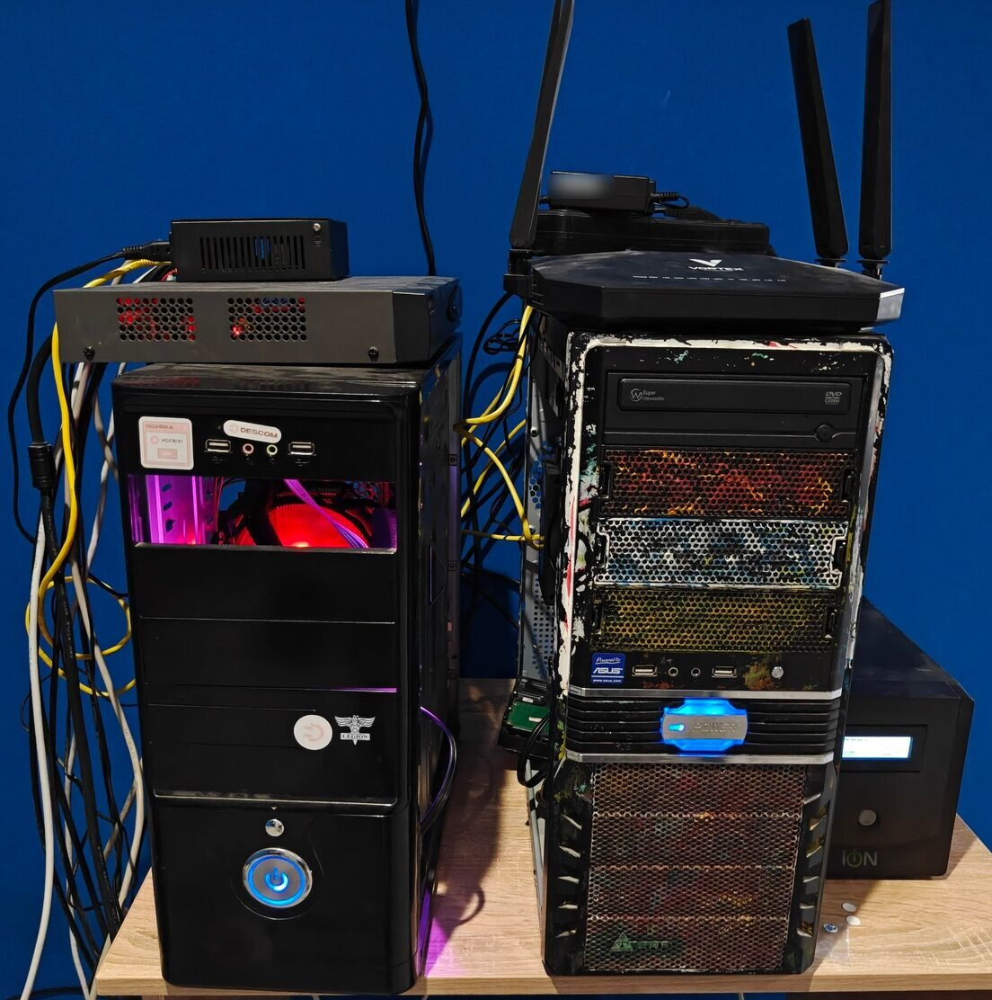
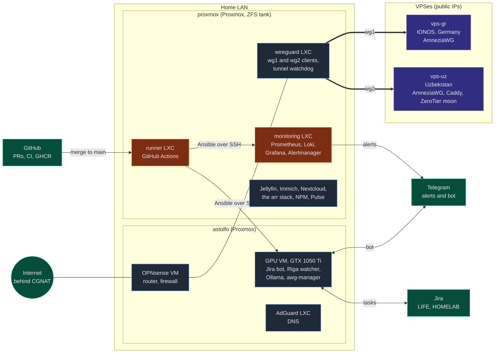
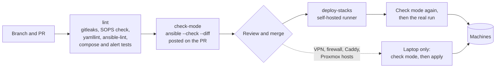
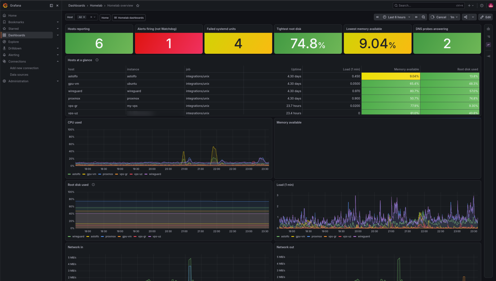
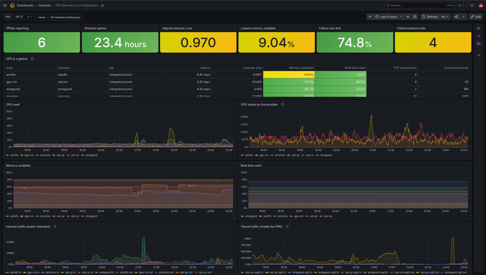
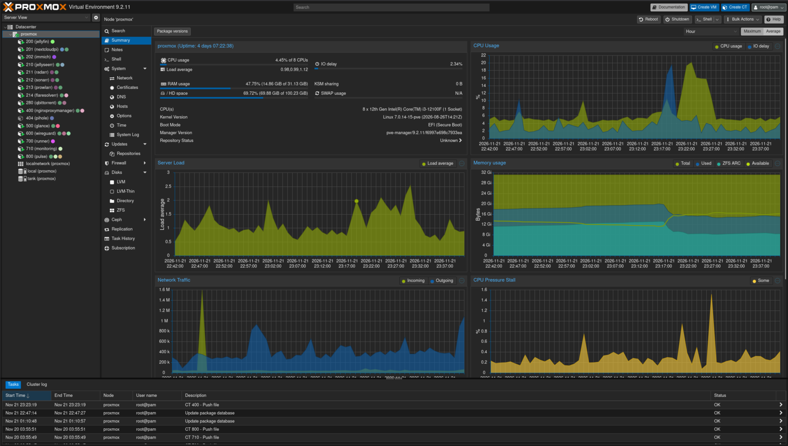

<div align="center">

# infra

**A homelab and two VPSes run as code.**
Every change is a pull request. A merged PR is the only way anything reaches a machine.

     

</div>

<p align="center">
  
  
</p>
<p align="center"><sub><b>The production environment.</b> Two PCs, a switch, a router, a UPS and a desk. Cable management is a future phase. If it works, it works.</sub></p>

> This is the public showcase of a private GitOps repository. The playbooks, the encrypted secrets, the runbooks
> and the captures of the hosts stay private. What you see here is a snapshot: the numbers, the status map and
> the screenshots are from 2026-11-21 to 2026-11-22.

---

## Status

    


<sub>Generated from docs/plan.md, the inventory and the monitoring stack by scripts/gen-status.py. Counts are top-level checklist items, so a phase that is running but still has open follow-ups shows partly filled. Rerun the script in any PR that changes the plan.</sub>

---

## At a glance

<!-- Numbers as of 2026-11-22. Source: ansible/inventory, `git log`, `gh pr list`, stacks/monitoring. -->

| | | | |
| :---: | :---: | :---: | :---: |
| **24** machines in the inventory | **18** LXCs, **2** VMs, **2** Proxmox nodes, **2** VPSes | **18** Ansible roles | **19** playbooks |
| **109** merged pull requests | **273** commits in 31 days | **4** Compose stacks, every image pinned | **11** pinned tool versions in `versions.yml` |
| **7** Grafana dashboards, **91** panels | **14** alert rules, **14** unit tests | **30 days** of logs in Loki | **22** runbooks, **4** decision records |

About 12,000 lines of YAML, Python and shell. Nothing is exposed to the internet today, on purpose.

---

## Topology

Home sits behind CGNAT, so nothing can connect in. Every path to the outside world goes out from home, through two AmneziaWG tunnels to VPSes in Germany and Uzbekistan.



The VPSes are also meant to act as a dead-man switch: if home stops answering, they message Telegram on their own, because the monitoring stack that would normally send the alert is the thing that went down. The `home_watch` role is written and tested against stubs; it is applied by hand, one VPS at a time, and has not been applied yet.

---

## How a change reaches a machine



- **Check mode comes first, always.** Nothing changes a live host until its diff is empty in `--check --diff`.
- **Two tiers of trust.** The runner deploys Docker stacks only. Anything that touches the VPN, the firewall, Caddy or the Proxmox hosts runs from the laptop, one VPS per run.
- **Pinned everything.** No `latest` tags. Every image is pinned by digest and binaries by version and SHA-256. `versions.yml` is wired for Renovate, which is configured but whose app is not installed yet, so bumps are manual for now.
- **Docs travel with code.** A PR that changes `ansible/roles/` or `stacks/` has to touch `docs/`, and CI checks it.

### Secrets

Secrets live in the repo as [SOPS](https://github.com/getsops/sops) ciphertext, in two [age](https://github.com/FiloSottile/age) key groups.

| Group | Holds | Who can decrypt |
| --- | --- | --- |
| `app` | Bot tokens, Grafana password, registry token | The runner and the laptop |
| `network` | The OPNsense config today, and anything that touches the VPN or firewall | The laptop only |

A compromised runner can therefore reach app secrets but never the keys to the network. The reasoning, including why there is no GitHub Pro approval gate, is in decision 0003 and decision 0002.

---

## Observability

Grafana Alloy on the six machines that matter (both Proxmox nodes, the GPU VM, the wireguard LXC and both VPSes) ships metrics and logs to one stack on its own LXC. Pulse watches availability separately, so a failure in the monitoring stack does not hide itself.

| | |
| --- | --- |
| **Metrics** | Prometheus, 30 s scrape, node, ZFS, SMART, GPU, AmneziaWG handshakes, blackbox probes of DNS and the Telegram API |
| **Logs** | Loki, 30 days, journald from those six machines, with a receiver for OPNsense syslog |
| **Alerts** | Alertmanager to Telegram with readable messages |
| **Dashboards** | Home, Homelab overview, Network, VPS (Germany and Uzbekistan), Disks and tunnels, Logs, Monitoring stack. All provisioned from the repo |

The 14 alert rules each have a unit test run by `promtool` in CI:
`Watchdog` · `HostSilent` · `DiskUsageHigh` · `DiskUsageCritical` · `LxcDiskUsageHigh` · `LxcDiskUsageCritical` · `DnsProbeFailing` · `MemoryPressure` · `SystemdUnitFailed` · `TunnelHandshakeStale` · `AwgWatchdogRestarted` · `ZfsPoolNotOnline` · `SmartDegrading` · `GpuTooHot`

---

## Phase by phase

| Phase | Area | State |
| :---: | --- | --- |
| 0 | Baseline and inventory of every machine | Done |
| 1 | Ansible baseline, check mode first | Running |
| 2 | CI, self-hosted runner, deploy on merge | Running |
| 3 | Docker stacks from the repo, SOPS-rendered env files | Running |
| 4 | Version pins and a weekly update report | Partly. Renovate app not installed yet |
| 5 | Prometheus, Loki, Grafana, Alertmanager, Telegram alerts | Running. The home watcher is written, not applied |
| 6 | App images built by their own repos, pulled from GHCR, pinned by digest | Running for Riga and the Jira bot |
| 7 | Backups and ZFS snapshots | Drafted, waits on a backup disk |
| 8 | Jira life bot: digest, weekly review, natural-language task entry | Running, still growing |
| 9 | Local LLM on the GPU VM (Ollama), 90% on a 30-message accuracy test | In progress |
| 11 | Public services | Design only. Nothing is public |

Details, open items and findings are tracked in docs/plan.md.

### Highlights

- **AmneziaWG on a kernel it was not built for.** The VPN kernel module is built from pinned tags through DKMS, so a kernel update can no longer silently break a tunnel at the next reboot. A watchdog restarts any tunnel whose handshake goes stale.
- **A life bot, not just a homelab.** A Telegram bot backed by Jira sends a morning digest and a weekly review, and is learning to parse plain-language tasks with a local model. A button press confirms before anything is created, changed or closed.
- **Lessons written down.** docs/gotchas.md records what went wrong and why: a full OPNsense disk that looked like random DNS failures, UDP ports that one firewall passed and another dropped, a config diff that printed a private key.

## Screenshots

All of these are live and provisioned from this repo, except the Proxmox consoles and the pull request.

| | |
| --- | --- |
|  |  |
| **Home.** Hosts reporting, firing alerts, tightest disk and memory, per-host table | **Network.** Internet and gateway latency, ping loss, DNS probes, VPN tunnel freshness, per-interface traffic |
|  |  |
| **VPS (Germany and Uzbekistan).** CPU stolen by the provider, public traffic against traffic inside the VPN | **A pull request.** Lint and docs checks must pass before a merge reaches a machine |
|  |  |
| **astolfo.** OPNsense, the GPU VM, AdGuard and ZeroTier | **proxmox.** The media, photos, files, VPN, runner and monitoring LXCs |


---

## Repository layout (private repo)

```
ansible/       inventory, 18 roles, 19 playbooks
stacks/        Docker Compose stacks, one folder per host and service
secrets/       SOPS-encrypted files only
monitoring/    rules, dashboards and Loki config live under stacks/monitoring
docs/          architecture, plan, gotchas, runbooks, decisions
scripts/       the checks CI runs, plus small wizards
baseline/      read-only captures of the machines on 2026-10-22
versions.yml   pinned tool versions, wired for Renovate
```

## About the private repository

Design notes, decision records, runbooks for recovery and key rotation, the inventory and the plan live in the private repository, along with the Ansible roles, the Compose stacks and the SOPS-encrypted secrets. Happy to walk through any of it.

## License

Copyright (c) 2026 ayzek-sempai. The text, diagrams, status graphics and photos here are licensed under [CC BY-NC-SA 4.0](https://creativecommons.org/licenses/by-nc-sa/4.0/): you may share and adapt them with credit, not for commercial use (including as part of a paid service), and anything you build on them must carry the same licence. The screenshots show third-party software (Proxmox, Grafana, GitHub); those names and logos belong to their owners.
